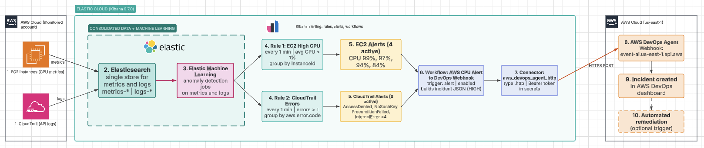

# Automated incident triage with Elastic Observability and AWS DevOps Agent

When Elastic raises an alert, AWS DevOps Agent starts investigating with your Elastic logs,
metrics, and traces, before an engineer opens a dashboard.

This sample connects the two services in both directions:

- **Push.** An Elastic alert opens a case. An Elastic workflow gathers evidence with Elasticsearch
  Query Language (ES|QL) and posts the incident to the AWS DevOps Agent webhook, which starts an
  investigation.
- **Pull.** While it investigates, AWS DevOps Agent queries Elastic through the Elastic Agent
  Builder Model Context Protocol (MCP) server, using a read-only API key and a 12-tool allowlist.

A sample `payment-service` with a fault switch lets you reproduce a database connection pool
failure on demand, so you can judge the findings against a known root cause. In our test, AWS
DevOps Agent received the incident 42 seconds after the failure began and finished its
investigation about 5 minutes after the failure began, naming the failing host, the exhausted
connection pool, and a mitigation plan for an engineer to review.

> **Cost:** AWS DevOps Agent bills for each second an agent actively works on an investigation or
> chat; each investigation here runs 5 to 8 minutes. Elastic Cloud Serverless bills for ingest and
> retention. The AWS CloudFormation stacks and AWS Identity and Access Management (IAM) roles are
> free. See [AWS DevOps Agent pricing](https://aws.amazon.com/devops-agent/pricing/) and
> [Elastic Cloud Serverless pricing](https://www.elastic.co/pricing). [Clean up](#clean-up) removes
> everything.

## Architecture



1. Workloads send telemetry to Elastic. The diagram shows Amazon EC2 metrics and AWS CloudTrail
   logs; this sample uses a local `payment-service` instrumented with EDOT Python instead.
2. Elasticsearch stores logs, metrics, and traces.
3. *Optional, not built here:* Elastic machine learning anomaly detection.
4. A Kibana alerting rule evaluates the data every minute. This sample uses one ES|QL rule:
   `payment-service` errors by host.
5. The rule raises an alert and opens a high-severity case.
6. An Elastic workflow runs on the new case, gathers evidence with two ES|QL queries, writes an
   audit copy, and builds the incident payload.
7. A Kibana HTTP connector holds the webhook URL and the bearer token as an encrypted secret.
8. The connector posts the incident to the AWS DevOps Agent webhook over HTTPS.
9. AWS DevOps Agent creates an incident and starts an investigation. While it investigates, it
   queries Elastic through the Elastic Agent Builder MCP server with a read-only key and a 12-tool
   allowlist. This pull path is not drawn in the diagram.
10. *Optional, not built here:* automated remediation. In this sample, the agent proposes a
    mitigation plan for an engineer to review.

The Region in the diagram is an example; any Region where AWS DevOps Agent is available works.

## What's in this sample

| Path | Contents |
|---|---|
| [`labs/`](labs/) | Six hands-on labs and facilitator notes for running this as a workshop |
| [`infra/agent-space.yaml`](infra/agent-space.yaml) | CloudFormation: Agent Space, IAM roles, operator web app, account association |
| [`infra/elastic-mcp.yaml`](infra/elastic-mcp.yaml) | CloudFormation: Elastic MCP server registration and Agent Space association with a tool allowlist |
| [`app/`](app/) | `payment-service`: FastAPI, SQLAlchemy, EDOT Python auto-instrumentation, runtime fault switch |
| [`loadgen/`](loadgen/) | Traffic generator (Python standard library only) |
| [`elastic-config/security/`](elastic-config/security/) | Read-only API key role descriptors for MCP access |
| [`elastic-config/connectors/`](elastic-config/connectors/) | Kibana HTTP connector (`.http`) for the webhook |
| [`elastic-config/rules/`](elastic-config/rules/) | ES\|QL alert rule, case template, audit index mapping |
| [`elastic-config/workflows/`](elastic-config/workflows/) | Elastic Workflow: case → evidence → webhook → case comment |
| [`scripts/`](scripts/) | Deploy, run, verify, and teardown scripts |

## Prerequisites

**AWS**

- An AWS account you control. Use a sandbox or non-production account: AWS DevOps Agent reads
  broadly across the accounts it monitors.
- A Region where AWS DevOps Agent is available: `us-east-1`, `us-east-2`, `us-west-2`,
  `ca-central-1`, `sa-east-1`, `ap-south-1`, `ap-southeast-1`, `ap-southeast-2`, `ap-northeast-1`,
  `ap-northeast-2`, `eu-central-1`, `eu-west-1`, `eu-west-2`, `eu-west-3`, `eu-north-1`. The
  examples use `ap-southeast-2`.
- An IAM principal that can deploy CloudFormation stacks, create IAM roles and pass them to
  `aidevops.amazonaws.com`, and manage AWS DevOps Agent resources (`aidevops:*`), including MCP
  server registration. Some organizations restrict which accounts may register third-party MCP
  servers; this appears as `AccessDenied` on `AWS::DevOpsAgent::Service`.
- AWS Command Line Interface (AWS CLI) version 2, configured for that account.

**Elastic**

- An Elastic Cloud Serverless Observability project on the **Complete** tier. Agent Builder and
  Elastic Workflows are not available on the Logs Essentials tier.
- A Kibana user who can create API keys, connectors, rules, cases, and workflows.

**Local machine**

- macOS or Linux with `bash`, `curl`, `git`, and Python 3.11 or later.

**Tested with:** Elastic Cloud Serverless Observability, Complete tier (Kibana 9.7.0); AWS CLI
version 2; Python 3.13; EDOT Python 1.19.0, FastAPI 0.162.4, uvicorn 0.54.0, SQLAlchemy 2.0.57.
The Elastic project and the Agent Space may be in different Regions. AWS DevOps Agent stores
investigation data, including what its tool calls return from Elastic, in the Agent Space Region.

## Setup

For a guided path with checkpoints and troubleshooting at every step, start with
[`labs/README.md`](labs/README.md). The condensed version follows.

### 1. Configure

```bash
git clone https://github.com/aws-samples/aws-generativeai-partner-samples.git
cd aws-generativeai-partner-samples/elastic/integrations/elastic-devops-agent-integration
cp .env.example .env
chmod 600 .env
```

Fill in the Kibana, Elasticsearch, MCP, and OTLP addresses, plus `AWS_REGION`. Do not leave
angle-bracket placeholders such as `<project>`: the scripts load `.env` with the shell, and the
shell reads `<` as a redirect.

### 2. Create three Elastic API keys

Create all three while signed in to Kibana. Elasticsearch does not let one API key create another
key that has privileges.

| `.env` variable | Purpose | Used by |
|---|---|---|
| `ELASTIC_ADMIN_API_KEY` | Creates and removes Elastic objects | `06-setup-elastic-alerting.sh`, `check-chain.sh`, `99-teardown.sh` |
| `OTLP_API_KEY` | Sends telemetry to the managed OTLP endpoint | `run-local.sh` |
| `ELASTIC_MCP_API_KEY` | Read-only access for AWS DevOps Agent | `05-register-elastic-mcp.sh`, `verify-telemetry.sh` |

The read-only key is defined in
[`elastic-config/security/mcp-readonly-api-key.json`](elastic-config/security/mcp-readonly-api-key.json). Run it
in Kibana **Developer Tools** > **Console** and copy the `encoded` value into `.env`.

### 3. Deploy and run

```bash
./scripts/01-deploy-agent-space.sh      # Agent Space, IAM roles, operator app, account association
# copy AgentSpaceId from the output into .env as AGENT_SPACE_ID
./scripts/05-register-elastic-mcp.sh    # register Elastic MCP server, 12 read-only tools
./scripts/run-local.sh start            # payment-service on two hosts, plus load
./scripts/verify-telemetry.sh 15        # confirm logs, metrics, traces in Elastic
```

### 4. Create the webhook

In the AWS DevOps Agent console, open your Agent Space, then **Capabilities** > **Webhook** >
**Configure** > **Add webhook**, and choose **API key**. Copy the URL and token into `.env` as
`DEVOPS_AGENT_WEBHOOK_URL` and `DEVOPS_AGENT_WEBHOOK_TOKEN`. The token is shown once; to get a new
one, rotate the webhook, which keeps the same URL.

### 5. Create the Elastic objects

```bash
./scripts/06-setup-elastic-alerting.sh  # audit index, HTTP connector, case template, alert rule, workflow
```

Re-run this script after any change to `.env` or to the files in `elastic-config/`.

## Run the demo

```bash
HEALTHY_MIN=5 FAULT_MIN=15 ./scripts/scenario.sh   # second terminal: healthy traffic, then a fault
./scripts/check-chain.sh                           # rule -> case -> workflow -> audit record
```

About a minute after `FAULT injected`, the rule opens a case, the workflow forwards it, and an
incident appears in the operator web app (**Launch via IAM** from the Agent Space). Investigation
findings appear within a few minutes.

To drive the service by hand instead:

```bash
./scripts/run-local.sh start|status|fault|heal|stop
```

`fault` shrinks the connection pool on `payments-host-a` from 10 connections (5 overflow, 5-second
timeout) to 2 (no overflow, 2-second timeout) and holds each connection for 1.5 seconds. Requests
fail with HTTP 503 while CPU and memory stay flat, so the failure cannot be explained by resource
pressure.

## Notes

**Only workshop cases are forwarded.** The workflow runs on every new Observability case but sends
only cases tagged `aws-devops-agent` to AWS DevOps Agent. The rule's case template adds the tag;
add it yourself to any case you create by hand. Other cases in the project are left alone.

**Case settings are merged, not replaced.** The setup script adds one case template
(`aws-devops-agent-high`) to your Observability case settings and leaves existing templates, the
case connector, and the closure setting unchanged. Teardown removes only that template.

**Why the workflow triggers on a case, not on every alert.** A case groups repeated alerts, so AWS
DevOps Agent receives one incident per problem, and responders in Kibana get a record of what was
sent. To trigger on alerts instead, change the workflow trigger to `type: alert` and attach the
workflow to the rule under **Actions** > **Add action** > **Workflows**; declaring the trigger
alone does not run it. Use one path or the other for a given incident, not both.

**MCP tool name length.** AWS DevOps Agent limits `<server name>_<tool name>` to 64 characters.
Elastic's longest tool name is 51 characters, so the MCP server name can be at most 12 characters.
This sample uses `elastic`.

**MCP transport.** AWS DevOps Agent supports MCP Streamable HTTP, which the Elastic endpoint uses.

**Webhook payload.** `eventType`, `incidentId`, `action`, `priority`, and `title` are required.
`priority` accepts `CRITICAL`, `HIGH`, `MEDIUM`, `LOW`, or `MINIMAL`. An invalid value still
returns HTTP 200 and no investigation starts, which is why the workflow writes every payload to the
`devops-agent-notifications` index. AWS DevOps Agent does not read the `data` field as
investigation context, so the ES|QL evidence goes into `description`.

**Elastic feature status.** At the time of writing, the `cases.caseCreated` workflow trigger is a
technical preview on Elastic Cloud Serverless. Elastic Workflows is generally available. Check the
Elastic release notes for your version.

**Connector type.** The workflow's `http` step uses the Kibana HTTP connector (`.http`), which is
distinct from the Webhook connector (`.webhook`). Kibana rejects the connector unless `authType` is
`null` when `hasAuth` is `false`.

## Security

| Control | How this sample applies it |
|---|---|
| Least privilege for Elastic | AWS DevOps Agent authenticates with an API key scoped to `read` and `view_index_metadata` on `logs-*`, `metrics-*`, `traces-*`, `.alerts-*`, plus read-only Agent Builder access. A write attempt returns HTTP 403 |
| Least privilege for AWS | The Agent Space role uses the AWS managed policy `AIDevOpsAgentAccessPolicy`; both roles trust only `aidevops.amazonaws.com`, restricted to your account and to Agent Space ARNs in your Region (`agentspace/*`) |
| Tool allowlist | The Agent Space may call 12 read-only Elastic tools out of the 54 the MCP server offers. Tools that change state are excluded |
| Secrets at rest | Kibana stores the webhook token as an encrypted secret header, so it never appears in the workflow. The Elastic key is a `NoEcho` CloudFormation parameter |
| Secrets in the repo | All credentials live in `.env`, which is excluded from git. `.env.example` holds placeholders only |
| Key expiration and rotation | The read-only key expires after 30 days. Rotation steps are in [Lab 2](labs/lab-02-mcp.md) |
| Local exposure | `payment-service` binds to `127.0.0.1` only. `/admin/fault` has no authentication and exists purely to reproduce a failure; do not expose it or ship anything like it |
| Audit trail | Every incident sent to AWS DevOps Agent is copied to `devops-agent-notifications` |

The read-only key passes on the AWS CLI command line when registering the MCP server, so run that
script on a machine only you use.

## Troubleshooting

| What you see | What to check |
|---|---|
| `syntax error near unexpected token` when a script loads `.env` | A value still has an angle-bracket placeholder |
| No telemetry in Elastic | Check `OTLP_ENDPOINT` and `OTLP_API_KEY`, then read `.run/payments-host-a.log` |
| Creating an API key fails with "requires an explicit role descriptor that is empty" | Create keys while signed in to Kibana, not with another API key |
| `exceeds the maximum allowed length of 64 characters` | The MCP server name is too long; use 12 characters or fewer |
| `AccessDenied` on `AWS::DevOpsAgent::Service` | Your identity or account is not permitted to register third-party MCP servers |
| Elastic tool calls fail with HTTP 401 after about 30 days | The read-only key expired; rotate it |
| The workflow `http` step returns HTTP 401 | The webhook token changed; update `.env` and re-run `06-setup-elastic-alerting.sh` |
| HTTP connector creation fails with `authType must be null` | Set `"authType": null` when `hasAuth` is `false` |
| Webhook returns HTTP 200 but no investigation starts | A required field is missing or an enum value is invalid; read the payload in the audit index |
| The workflow does not run for new cases | The trigger condition must be `event.owner: "observability"`. `O11Y Solution` and `securitySolution` do not match Observability cases |
| No new case on a repeated test | The rule groups alerts into an open case for 7 days; close open cases |
| A second incident shows status **Linked** | AWS DevOps Agent attached it to an open investigation of the same problem |

## Clean up

1. Remove the webhook: Agent Space **Capabilities** tab > **Webhook** > **Actions** > **Remove**.
   CloudFormation does not manage this console-created resource.
2. Review what the teardown script will delete. It is a dry run by default:
   ```bash
   ./scripts/99-teardown.sh
   ```
   It deletes only the two stacks named by `MCP_STACK_NAME` and `STACK_NAME` in `.env`, never
   stacks matched by prefix or tag. Confirm the plan, then delete:
   ```bash
   ./scripts/99-teardown.sh --yes --purge-telemetry
   ```
   Narrow the scope with `--aws`, `--elastic`, or `--local`.
3. Revoke the Elastic API keys in Kibana (**Developer Tools** or **Admin and settings** >
   **API keys**): `aws-devops-agent-mcp-readonly`, `aws-devops-agent-setup`, and the ingest key.
4. Delete `.env`.

## Resources

- [AWS DevOps Agent user guide](https://docs.aws.amazon.com/devopsagent/latest/userguide/)
- [Elastic Agent Builder MCP server](https://www.elastic.co/docs/explore-analyze/ai-features/agent-builder/mcp-server)
- [Elastic Workflows](https://www.elastic.co/docs/explore-analyze/workflows)
- [Elastic Distribution of OpenTelemetry (EDOT) for Python](https://www.elastic.co/docs/reference/opentelemetry/edot-sdks/python/)
- [Model Context Protocol](https://modelcontextprotocol.io/)
