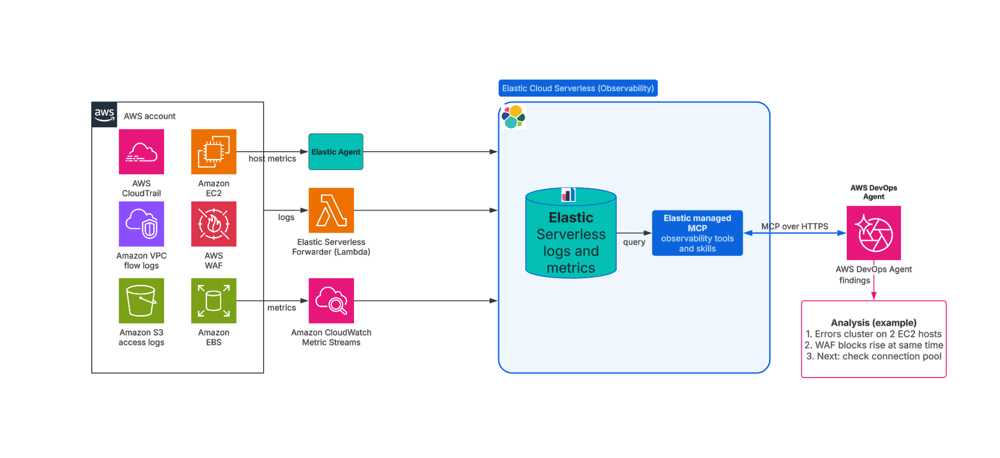
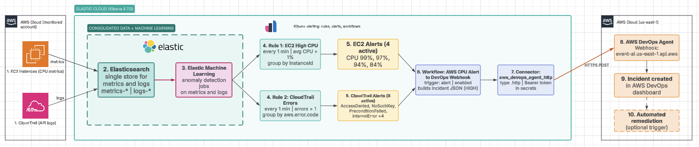

# Workshop: automated incident triage with Elastic and AWS DevOps Agent

Six labs, about 2 hours. You connect AWS DevOps Agent to Elastic Observability, break a sample
service on purpose, and watch an Elastic alert start an AI-led investigation that reads your
Elastic telemetry.

## What you build

```
payment-service (2 hosts)                Elastic Cloud Serverless            AWS DevOps Agent
  FastAPI + EDOT Python   ──OTLP──▶   logs / metrics / traces                  Agent Space
                                              │                                     │
                                       alert rule (ES|QL)                            │
                                              │                                      │
                                         case created                                │
                                              │                                      │
                                      Elastic Workflow  ──webhook (HTTPS)──▶  investigation
                                              ▲                                      │
                                              └────── MCP tool calls ◀───────────────┘
```



*Figure 1. The big picture: telemetry lands in Elastic, and AWS DevOps Agent queries it over MCP.*



*Figure 2. The detailed flow from alert to investigation. The Region shown is an example. Boxes 3 (machine learning) and 10 (automated remediation), and the Amazon EC2 and AWS CloudTrail sources, are optional and not built in these labs; the labs use a local sample service instead.*

Two paths, each with its own lab:

- **Push:** Elastic tells AWS DevOps Agent that something is wrong (Labs 4 and 5).
- **Pull:** AWS DevOps Agent queries Elastic while it investigates (Labs 2 and 3).

## Labs

| Lab | Title | Time | You finish with |
|---|---|---|---|
| [0](lab-00-setup.md) | Environment setup | 20 min | Accounts checked, `.env` complete, three Elastic API keys |
| [1](lab-01-telemetry.md) | Send telemetry to Elastic | 15 min | `payment-service` running, logs/metrics/traces in Elastic |
| [2](lab-02-mcp.md) | Give AWS DevOps Agent read access to Elastic | 20 min | Agent Space with the Elastic MCP server, 12 read-only tools |
| [3](lab-03-investigate.md) | Investigate a failure by hand | 20 min | An investigation that finds the root cause from Elastic data |
| [4](lab-04-webhook.md) | Connect Elastic alerts to AWS DevOps Agent | 25 min | Webhook, HTTP connector, workflow, alert rule |
| [5](lab-05-end-to-end.md) | Watch the whole chain run | 20 min | A failure that triages itself, start to finish |
| [6](lab-06-cleanup.md) | Clean up | 10 min | Everything removed, keys revoked |

Run them in order. Each lab opens with what it assumes you already did.

## Before the workshop

Each participant needs the items in [Lab 0](lab-00-setup.md): a sandbox AWS account in a Region
where AWS DevOps Agent is available, an Elastic Cloud Serverless Observability project on the
Complete tier, and a Mac or Linux machine with `bash`, `curl`, `git`, and Python 3.11 or later.

If you are running this for a group, read [FACILITATOR.md](FACILITATOR.md) first. It covers
shared versus per-participant resources, timing, cost, and the failure modes that come up most.

## Cost

AWS DevOps Agent bills for each second an agent actively works; each investigation in these labs
runs 5 to 8 minutes. Elastic Cloud Serverless bills for ingest and retention. The CloudFormation
stacks and IAM roles are free. Lab 6 removes everything. See
[AWS DevOps Agent pricing](https://aws.amazon.com/devops-agent/pricing/) and
[Elastic Cloud Serverless pricing](https://www.elastic.co/pricing).

## If you get stuck

Each lab ends with a troubleshooting table. The repository
[README](../README.md#troubleshooting) has the full list.
