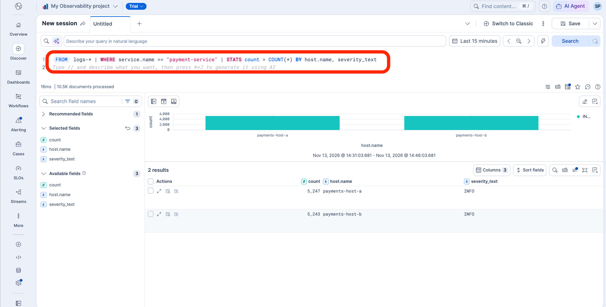

# Lab 1: Send telemetry to Elastic

**Time:** 15 minutes
**You start with:** a complete `.env` from [Lab 0](lab-00-setup.md).
**You finish with:** `payment-service` running on two simulated hosts, with logs, metrics, and
traces in Elastic, and a fault you can inject on demand.

## About the sample service

`payment-service` is a small FastAPI application that writes payments to a database through a
SQLAlchemy connection pool. A connection pool is a fixed set of reusable database connections;
when every connection is busy, new requests wait, and if they wait too long they fail. That is the
failure you will investigate in Lab 3.

The Elastic Distribution of OpenTelemetry (EDOT) for Python instruments the application without
code changes and sends its telemetry straight to the Elastic Cloud Managed OTLP Endpoint.

## 1. Start the service

```bash
./scripts/run-local.sh start
```

The first run creates a Python virtual environment and installs dependencies, which takes a minute
or two. The script then starts:

- `payments-host-a` on `127.0.0.1:8001`
- `payments-host-b` on `127.0.0.1:8002`
- a load generator sending 6 payments per second to each host

Both processes listen only on `127.0.0.1`, so nothing is reachable from your network.

```bash
./scripts/run-local.sh status
```

Expect `{"status":"ok","host":"payments-host-a","fault_mode":"none"}` for both hosts.

## 2. Confirm the data reached Elastic

Wait two minutes for the first metrics to arrive, then:

```bash
./scripts/verify-telemetry.sh 15
```

This runs five Elasticsearch Query Language (ES|QL) queries, the same ones AWS DevOps Agent will
run later. A healthy run shows requests on both hosts under **HTTP status by host**, zero failures,
and no rows under **Errors by host**.

Now look at the same data in Kibana. Open **Discover**, switch to ES|QL, and run:

```
FROM logs-* | WHERE service.name == "payment-service"
| STATS count = COUNT(*) BY host.name, severity_text
```

You should see INFO rows for both hosts.



*Screenshot 3. Healthy traffic in Kibana **Discover**: roughly equal INFO counts on both hosts and no errors.*

Try the traces too:

```
FROM traces-* | WHERE service.name == "payment-service" AND span.name == "POST /payments"
| STATS requests = COUNT(*), p95_ms = PERCENTILE(duration, 95) / 1000000 BY host.name
```

Both hosts should answer in tens of milliseconds.

**Where the data lands:** `logs-generic.otel-default`, `traces-generic.otel-default`, and
`metrics-generic.otel-default`. The read-only key from Lab 0 covers all three.

## 3. Break it, then fix it

The service has a fault switch. Injecting the fault shrinks host-a's connection pool from 10
connections (5 overflow, 5-second timeout) to 2 (no overflow, 2-second timeout), and makes each
payment hold its connection for 1.5 seconds.

```bash
./scripts/run-local.sh fault
```

Wait a minute, then look again:

```bash
./scripts/verify-telemetry.sh 5
```

Host-a now reports errors and failed requests; host-b stays clean. Two numbers matter for the rest
of the workshop:

- **DB span latency** on host-a jumps to roughly 1,500 ms at p95, against tens of milliseconds on host-b.
- **CPU and memory stay flat on both hosts.** The service is not short of resources. It is short of
  connections. An investigation that only looks at CPU and memory will find nothing.

Clear the fault before moving on:

```bash
./scripts/run-local.sh heal
```

> `/admin/fault` has no authentication and is bound to `127.0.0.1`. It exists so you can reproduce
> a failure on demand. Never ship an endpoint like it.

## Check your work

- `./scripts/run-local.sh status` shows both hosts `ok` with `fault_mode: none`.
- `./scripts/verify-telemetry.sh 15` shows requests on both hosts and no errors.
- You have seen `payment-service` logs and traces in Kibana Discover.

## Troubleshooting

| What you see | What to check |
|---|---|
| `port 8001 in use; run stop first` | A previous run is still going. `./scripts/run-local.sh stop` |
| Service starts but no data in Elastic | Check `OTLP_ENDPOINT` and `OTLP_API_KEY`, then read `.run/payments-host-a.log` for export errors |
| `verify-telemetry.sh` returns empty tables | Give it two more minutes, and confirm `ELASTIC_MCP_API_KEY` is set |
| Instrumentation warnings in the host log about SQLAlchemy | `app/requirements.txt` pins SQLAlchemy below 2.1 for this reason. Recreate the venv: `rm -rf app/.venv && ./scripts/run-local.sh start` |

**Next:** [Lab 2: Give AWS DevOps Agent read access to Elastic](lab-02-mcp.md)
