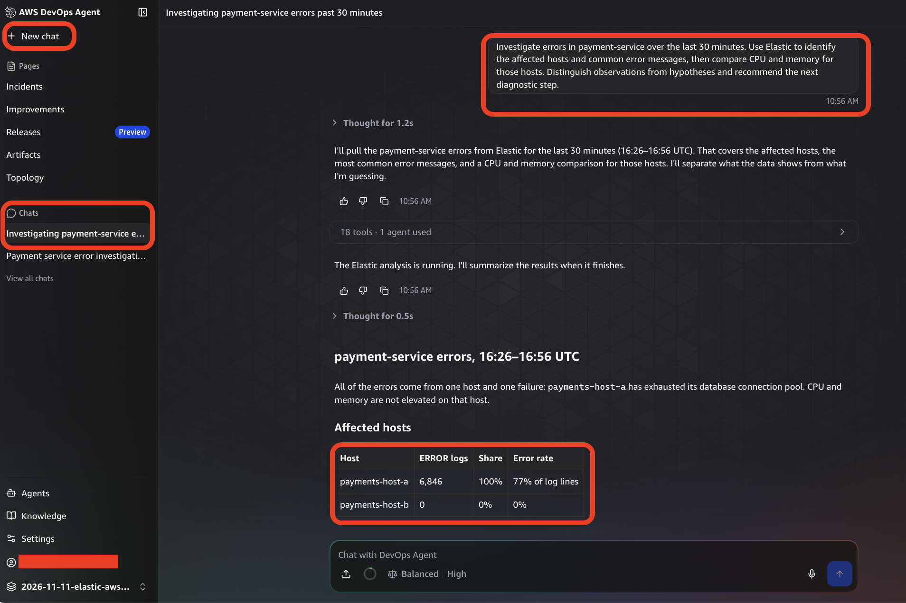

# Lab 3: Investigate a failure by hand

**Time:** 20 minutes (10 of them waiting)
**You start with:** the Elastic MCP server attached to your Agent Space from [Lab 2](lab-02-mcp.md).
**You finish with:** an AWS DevOps Agent investigation that found the root cause using only Elastic
data, and a clear idea of what it can and cannot see.

This lab tests the pull path on its own, before any alerting exists. You ask the question; the
agent does the work.

## 1. Break the service

```bash
./scripts/run-local.sh fault
```

Wait 10 minutes. The agent needs enough failing requests in the window to draw conclusions from.
Use the time to read the next section.

## 2. What the agent has to work with

The agent does not know what you broke. It knows only what Elastic holds:

- **Logs** from both hosts, including `payment-service` error messages.
- **Traces** showing how long each payment took and where the time went.
- **Metrics**, including process-level CPU and memory.
- **Field names and index mappings**, so it can discover what exists before querying.

It has to find the failing host, read the errors, rule out a resource problem, and form a
hypothesis. That is the same sequence an on-call engineer follows.

## 3. Ask the question

In the AWS DevOps Agent console, go to **Agent spaces**, find your Agent Space, and choose
**Launch via IAM**. In the operator web app, choose **New chat** and paste:

```text
Investigate errors in payment-service over the last 30 minutes. Use Elastic to identify the
affected hosts and common error messages, then compare CPU and memory for those hosts.
Distinguish observations from hypotheses and recommend the next diagnostic step.
```

The prompt does three jobs. It sets a time window, it names the service so the agent can find it,
and it asks for observations and hypotheses to be kept apart, which stops a guess from reading
like a fact.

## 4. Read the answer

The agent first states its plan, then runs Elastic queries. A collapsed line such as
**18 tools · 1 agent used** lists the calls it made; expand it to see each query and its result.
Tool names start with `elastic_`, the MCP server name from Lab 2.



*Screenshot 5. The investigation in the operator web app. The table shows every error on `payments-host-a` and none on `payments-host-b`.*

In our run, the agent reported:

- Every error came from `payments-host-a`. Host-a logged 6,846 errors in the window, which was 100%
  of all errors and 77% of its own log lines. `payments-host-b` logged none.
- All errors were the same failure: `QueuePool limit of size 2 overflow 0 reached, connection timed
  out, timeout 2.00`.
- CPU and memory were not elevated on host-a.
- Leading hypothesis: host-a's connection pool is too small or configured differently from host-b.
  Suggested next step: compare the pool settings on both hosts and find when the errors began.

That matches the fault you injected in step 1.

## 5. Notice the gaps

Compare the answer with what you know is true. In our run the agent missed three things:

| What it missed | Why |
|---|---|
| Host CPU and memory | The sample sends process metrics (`metrics.process.runtime.cpython.*`), not host metrics (`system.*`). The agent looked for the usual host fields and found none |
| The connection pool metric | `metrics.db.client.connections.usage` exists in the data and would have confirmed exhaustion directly |
| When the problem started | Host-a logged `fault mode changed to pool_exhaustion` at the moment of injection |

None of these are failures of the integration. They are the difference between an agent exploring
unfamiliar data and an agent handed the right queries. Two fixes follow from this, and both appear
later:

- **Give it evidence up front.** The workflow in Lab 4 runs ES|QL queries and puts the results in
  the incident description. The investigation in Lab 5 finds the onset and the configuration change
  because of it.
- **Give it reviewed queries.** Custom Agent Builder ES|QL tools let your team encode the checks
  that matter for your services, so the agent runs the same ones every time.

## 6. Clear the fault

```bash
./scripts/run-local.sh heal
```

Do this before Lab 4. The alert rule you create there starts evaluating immediately, and a running
fault would open a case before you are ready for it.

## Check your work

- The investigation named `payments-host-a` and the connection pool.
- You expanded the tool list and saw calls prefixed with `elastic_`.
- `./scripts/run-local.sh status` shows `fault_mode: none` on both hosts.

## Troubleshooting

| What you see | What to check |
|---|---|
| The agent says it found no `payment-service` data | Telemetry is not arriving. Re-run `./scripts/verify-telemetry.sh 15` |
| The agent reports an authentication error calling Elastic | The read-only key expired or changed. Rotate it as in Lab 2 |
| The answer has no `elastic_` tool calls | The MCP server is not attached to this Agent Space. Check the **Capabilities** tab |
| "Launch via IAM" does nothing | Your identity cannot assume the operator app role. Check the role created in Lab 2 |

**Next:** [Lab 4: Connect Elastic alerts to AWS DevOps Agent](lab-04-webhook.md)
