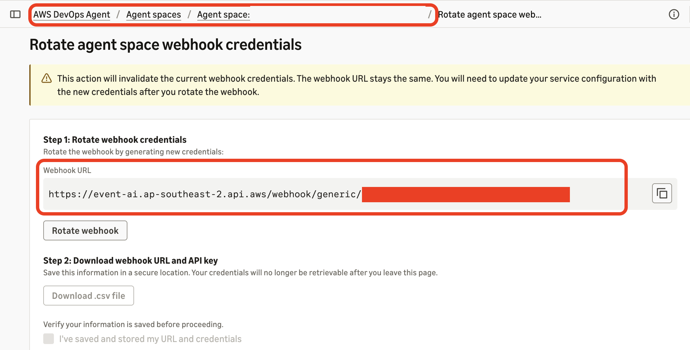

# Lab 4: Connect Elastic alerts to AWS DevOps Agent

**Time:** 25 minutes
**You start with:** a working investigation from [Lab 3](lab-03-investigate.md) and a healthy
service (`fault_mode: none`).
**You finish with:** a webhook, an HTTP connector, a workflow, and an alert rule, tested with a
case you create yourself.

This is the push path: Elastic tells AWS DevOps Agent that something is wrong.

## 1. Create the webhook in AWS DevOps Agent

A webhook is an address another system can post events to. An Agent Space supports one API key
webhook and one hash-based message authentication code (HMAC) webhook. This lab uses the API key
type.

1. In the AWS DevOps Agent console, open your Agent Space.
2. On the **Capabilities** tab, find **Webhook** and choose **Configure**.
3. Choose **Add webhook**.
4. For **Webhook authentication type**, choose **API key**, and create it.
5. Copy the webhook URL and token into `.env`:

```bash
DEVOPS_AGENT_WEBHOOK_URL=https://event-ai.<region>.api.aws/webhook/generic/<id>
DEVOPS_AGENT_WEBHOOK_TOKEN=<token>
```

The console shows the token once. If you lose it, choose **Actions** > **Edit** >
**Rotate webhook**. The URL stays the same and you get new credentials, which you can download as
a `.csv` file. Then update `.env` and re-run the script in step 2.



*Screenshot 6. Rotating the webhook. The URL has the form `https://event-ai.<region>.api.aws/webhook/generic/<id>` and does not change; the new credentials can be downloaded once.*

> The webhook is created in the console, not by CloudFormation, so Lab 6 removes it by hand.

## 2. Create the Elastic objects

```bash
./scripts/06-setup-elastic-alerting.sh
```

The script is idempotent: run it again whenever you change a setting or a file. It creates five
things.

**Audit index** `devops-agent-notifications` stores a copy of every incident sent. When an
investigation does not start, this is where you look first.

**HTTP connector** `AWS DevOps Agent HTTP` holds the webhook URL and token. Kibana encrypts the
`Authorization` header as a secret header, so the token never appears in the workflow.

> **Screenshot 7 pending.** Kibana **Stack Management** > **Connectors** showing the `AWS DevOps Agent HTTP` connector of type HTTP, opened to show the secret header field without its value.  
> When captured, save it as `images/screenshot-07-kibana-connector.png` and replace this note with ``.

```json
{
  "name": "AWS DevOps Agent HTTP",
  "connector_type_id": ".http",
  "config": {
    "url": "${DEVOPS_AGENT_WEBHOOK_URL}",
    "headers": { "Content-Type": "application/json" },
    "hasAuth": false,
    "authType": null
  },
  "secrets": {
    "secretHeaders": { "Authorization": "Bearer ${DEVOPS_AGENT_WEBHOOK_TOKEN}" }
  }
}
```

Note the connector type. Elastic Workflows' `http` step uses the HTTP connector (`.http`), which is
a different type from the Webhook connector (`.webhook`). Also note `"authType": null`: Kibana
rejects the connector if `hasAuth` is `false` and `authType` is set.

**Case template** `aws-devops-agent-high` sets new cases to `high` severity. Without it, cases a
rule opens start at `low`, and the workflow would send AWS DevOps Agent a LOW priority incident.

**Alert rule** `payment-service error spike` is an Elasticsearch query rule in ES|QL mode. It runs
every minute over a 5-minute window:

```
FROM logs-* | WHERE service.name == "payment-service" AND severity_text == "ERROR"
| STATS errors = COUNT(*) BY host.name | WHERE errors > 50
```

Its Cases action opens one case from the template and adds later alerts to the same case for 7
days. That grouping is why AWS DevOps Agent receives one incident per problem instead of one per
alert.

**Workflow** `AWS DevOps Agent - Case Notification`
([`elastic-config/workflows/case-to-devops-agent.yaml`](../elastic-config/workflows/case-to-devops-agent.yaml))
runs when an Observability case is created:

```yaml
triggers:
  - type: cases.caseCreated
    on:
      condition: 'event.owner: "observability"'
```

Its seven steps, in order:

| Step | What it does |
|---|---|
| `fetch_case` | The trigger carries only a case ID, so the workflow fetches the full case |
| `errors_by_host` | ES\|QL: which services and hosts are producing errors |
| `top_error_messages` | ES\|QL: the most frequent error messages, with payment IDs masked so identical errors group together |
| `build_payload` | Builds the incident, mapping Elastic case severity to AWS DevOps Agent priority |
| `audit_notification` | Writes a copy to the audit index |
| `send_to_aws_devops_agent` | POSTs through the HTTP connector |
| `comment_on_case` | Leaves a note on the case for responders in Kibana |

Three details are easy to get wrong:

- AWS DevOps Agent requires `eventType`, `incidentId`, `action`, `priority`, and `title`.
  `priority` must be `CRITICAL`, `HIGH`, `MEDIUM`, `LOW`, or `MINIMAL`. Send anything else and the
  webhook still answers HTTP 200, but no investigation starts.
- AWS DevOps Agent does not read the `data` field as investigation context, so the ES|QL evidence
  goes into `description`.
- In the workflow template language, `{{ }}` renders a value as text and `${{ }}` passes the object
  through unchanged. That is how the same payload object is both audited and sent.

## 3. Test with a case you create

Disable the rule first, so it does not open its own case while you are testing.

1. In Kibana, open **Observability** > **Alerts** > **Manage rules** and disable
   `payment-service error spike`.
2. Inject the fault and wait 5 minutes: `./scripts/run-local.sh fault`
3. Open **Observability** > **Cases** > **Create case**. Title it
   `payment-service errors on payments-host-a`, set **Severity** to **High**, add the tag
   `e2e-test` so Lab 6 cleans it up, and create it.
4. Check each hop:

```bash
./scripts/check-chain.sh
```

This prints the rule status, recent cases, workflow executions, and audit records. In Kibana,
**Workflows** > `AWS DevOps Agent - Case Notification` > **Executions** shows the run with all
seven steps completed, and the case has a comment beginning
`Forwarded to AWS DevOps Agent by workflow execution`.

> **Screenshot 8 pending.** Kibana **Workflows** > `AWS DevOps Agent - Case Notification` > **Executions**, latest run, with all seven steps completed and their durations.  
> When captured, save it as `images/screenshot-08-kibana-workflow-execution.png` and replace this note with ``.

5. In the operator web app, open **Incidents**. A HIGH priority incident carries your case title,
   and **Triggered By** reads `Event Channel`, meaning it arrived through the webhook.

For reference, our run: case created at 19:05:27.7 UTC, workflow started 2 seconds later, all seven
steps done in about 2 seconds (the HTTP call took 923 ms), incident created at 19:05:31.4, about 4
seconds after the case.

## 4. Reset

```bash
./scripts/run-local.sh heal
```

Close the test case in **Observability** > **Cases**, and leave the rule disabled until Lab 5
tells you to enable it.

## Check your work

- `./scripts/check-chain.sh` shows a completed workflow execution and an audit record.
- The case has the workflow's comment.
- An incident appeared in the operator web app with priority HIGH.

## Troubleshooting

| What you see | What to check |
|---|---|
| Connector creation fails with `authType must be null` | Set `"authType": null` when `hasAuth` is `false` |
| The `http` step returns HTTP 401 | The webhook token is wrong or was rotated. Update `.env` and re-run the script |
| The `http` step reports a `webhookId` pattern error | `DEVOPS_AGENT_WEBHOOK_URL` is still a placeholder |
| The webhook returns HTTP 200 but no incident appears | A required field is missing or an enum value is invalid. Read the payload in the audit index |
| The workflow never runs | The trigger condition must be `event.owner: "observability"`. `O11Y Solution` and `securitySolution` do not match Observability cases |
| `set ELASTIC_ADMIN_API_KEY in .env` | The setup script needs the admin key, not the read-only key |

**Next:** [Lab 5: Watch the whole chain run](lab-05-end-to-end.md)
