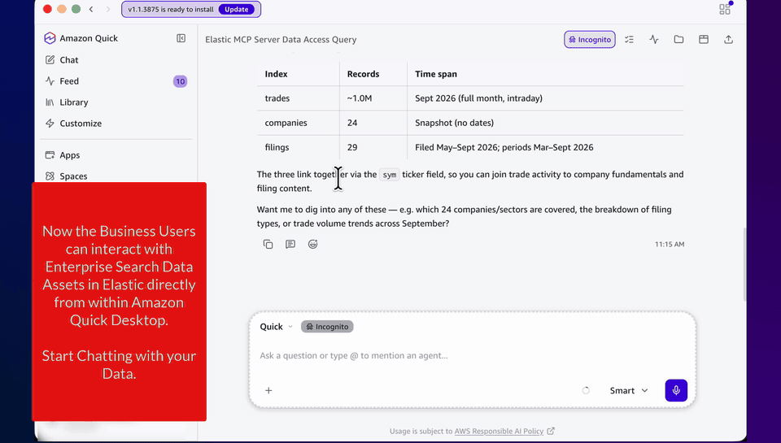
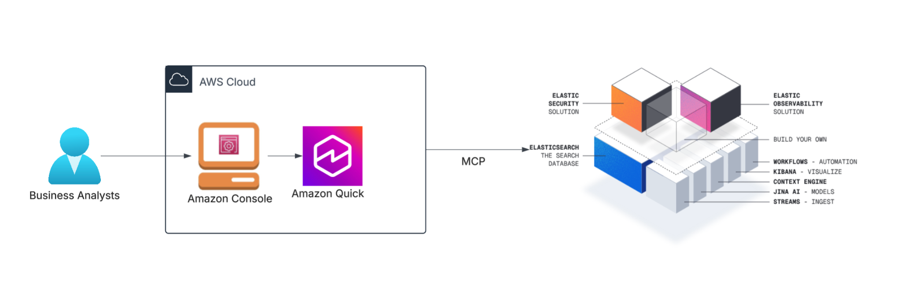
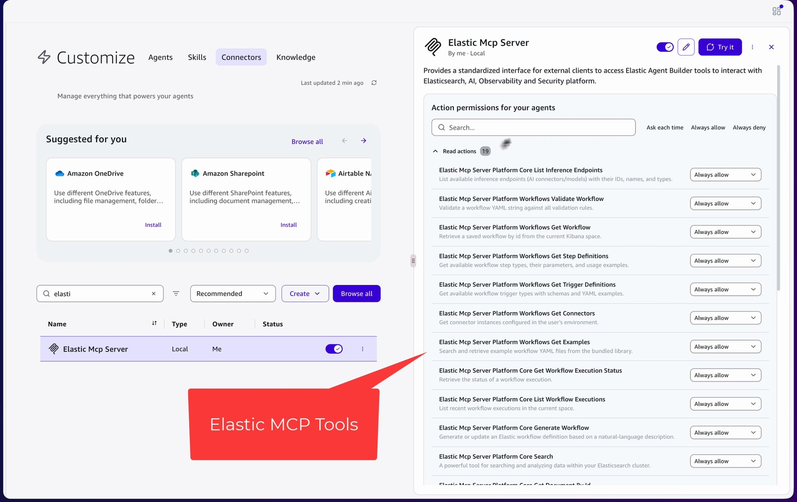
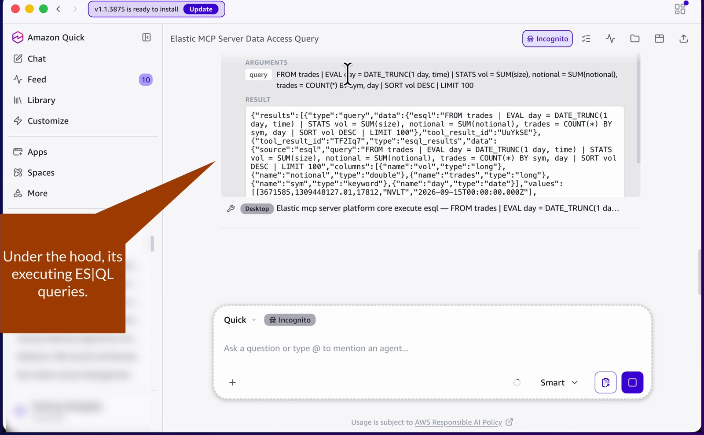
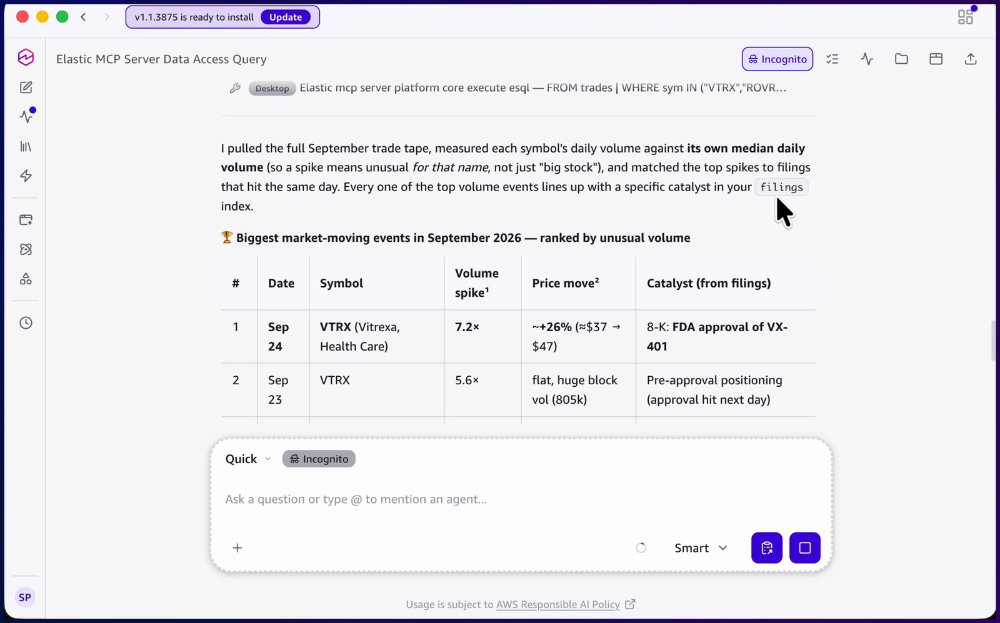
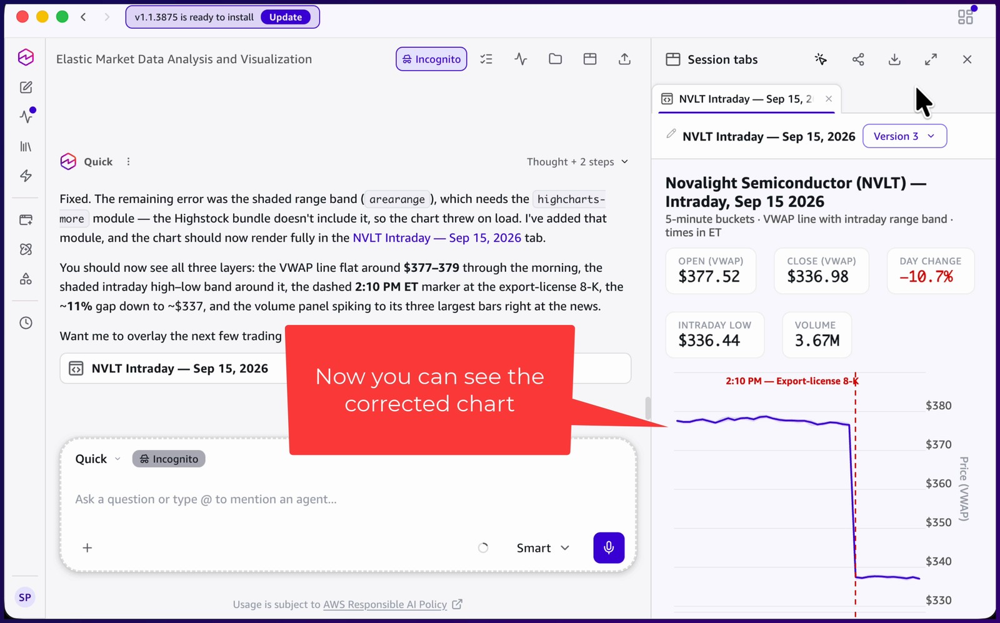
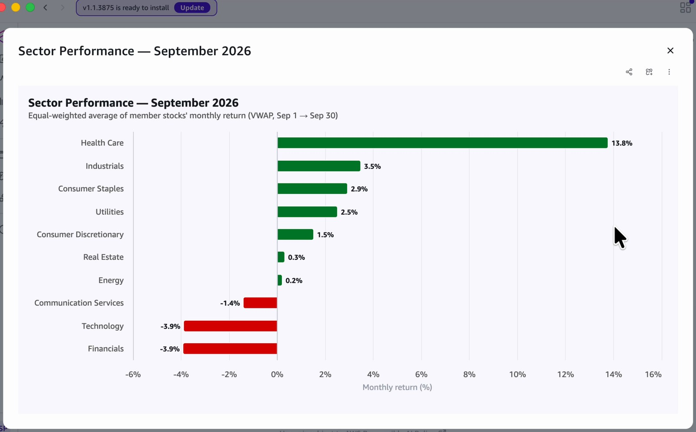

# Market intelligence for business users with Amazon Quick and the Elastic MCP server

A portfolio analyst uses [Amazon Quick](https://aws.amazon.com/quick/) to investigate a month of trade data, company fundamentals, and SEC filing excerpts stored in Elasticsearch, without writing a query. Amazon Quick connects to the [Elastic Agent Builder MCP server](https://www.elastic.co/docs/explore-analyze/ai-features/agent-builder/mcp-server) over OAuth 2.1, finds market-moving events, explains them from filings, and charts the results.



> All companies, tickers, prices, and filings in this sample are **fictional**. Any resemblance of a ticker to a real listed security is coincidental.

## Architecture



1. The analyst asks a question in Amazon Quick chat.
2. Amazon Quick selects tools from the Elastic MCP server connector. The connector runs [`mcp-remote`](https://www.npmjs.com/package/mcp-remote) on the analyst's machine, which signs in to Elastic with OAuth 2.1 and forwards MCP requests over HTTPS to the Agent Builder MCP endpoint in Kibana.
3. Elastic Agent Builder runs the tool (an ES|QL query, a semantic search over filings, or one of the curated `mi_*` tools in this sample) with the analyst's own Elastic permissions.
4. Elasticsearch returns the results. Amazon Quick reasons over them, answers in natural language, and renders charts on request.

## What's in this sample

| Path | Purpose |
|---|---|
| `scripts/01_create_indices.py` | Creates the `trades`, `companies` (lookup index), and `filings` (`semantic_text`) indices |
| `scripts/02_load_data.py` | Generates and loads about 1M trades for September 2026, 24 companies, and 29 filing excerpts (fixed seed, so results are reproducible) |
| `scripts/universe.py`, `scripts/filings_corpus.py` | The fictional company universe, trading calendar, planted market events, and filing text |
| `scripts/agent_tools.py`, `scripts/04_create_agent_tools.py` | Nine curated Agent Builder ES\|QL and search tools (the "context layer") and the script that registers them |
| `scripts/03_create_api_key.py`, `scripts/05_verify_mcp.py` | Optional: read-only API key and an MCP check with it (for automation or Elastic Cloud Hosted) |
| `scripts/05b_verify_mcp_oauth.py`, `scripts/08_e2e_mcp_tests.py` | MCP checks over OAuth, and end-to-end tests that check the answer to each demo question |
| `scripts/06_validate_demo.py` | Prints the expected answer to every demo question |
| `scripts/07_export_for_quick.py` | Optional: exports aggregated CSVs for an Amazon Quick Sight dashboard |
| `demo/demo-script.md` | Analyst walkthrough with prompts and expected answers |
| `quick/chat-agent-config.md` | Optional Amazon Quick chat agent persona and tool-routing instructions |
| `quick/dashboard.md` | Optional Amazon Quick Sight dashboard layout |

### Data model

| Index | Docs | Contents |
|---|---|---|
| `trades` | 1,004,837 | Tick data for 21 sessions in Sept 2026: `time` (UTC), `sym`, `sector`, `price`, `size`, `notional`, `side`, `exchange`, `is_block` |
| `companies` | 24 | Fundamentals in `index.mode: lookup`, joined to trades with ES\|QL `LOOKUP JOIN` for P/E, EV/EBITDA, and market cap |
| `filings` | 29 | 10-K, 10-Q, and 8-K excerpts in a `semantic_text` field |

The data contains planted events for the analyst to discover:

| Date | Ticker | Event | Effect in the data |
|---|---|---|---|
| 3 Sep | CRTL | Earnings beat | +7.5% gap |
| 9 Sep | HRBR | Credit warning on commercial real estate loans | −7.3%, KEYS falls in sympathy |
| 15 Sep | NVLT | Export-control 8-K at 14:10 ET | −10.7% intraday |
| 18 Sep | ROVR | Recall | −6% gap |
| 22 Sep | ORCH | 10-K with new risk factors | Volume about 2× for the week |
| 22–23 Sep | VTRX | One-sided block buying | Precedes the FDA approval on 24 Sep (+20%) |
| 29 Sep | LDGR | CEO exit | −5% gap |

The month also shows a defensive sector rotation.

## Prerequisites

- An [AWS account](https://docs.aws.amazon.com/accounts/latest/reference/welcome-first-time-user.html)
- Amazon Quick with an Author Pro subscription, and the Amazon Quick desktop app
- An [Elastic Cloud Serverless](https://www.elastic.co/cloud/serverless) project (Elasticsearch). OAuth for the MCP server is available on Serverless projects only; Elastic Cloud Hosted deployments on version 9.2 or later can use an API key instead.
- Python 3.11 or later, Git, and Node.js 18 or later (for `npx mcp-remote`)

**Cost:** this sample creates no AWS resources. You pay for your Amazon Quick subscription and for Elastic Cloud Serverless usage while the data is stored and queried.

**Tested with:** Elastic Cloud Serverless (Elasticsearch 9.6), Amazon Quick desktop app 1.1, Python 3.13, Node.js 20, and `mcp-remote` 0.14.3 (October 2026).

## Setup

### 1. Load the sample data

```bash
cd elastic/integrations/elastic-quick-integration
python3 -m venv .venv && source .venv/bin/activate
pip install -r scripts/requirements.txt
cp .env.example .env    # set ELASTIC_URL, KIBANA_URL, ELASTIC_ADMIN_API_KEY
python scripts/01_create_indices.py    # --recreate rebuilds only these three indices
python scripts/02_load_data.py         # about 30 seconds; --trades N to resize
```

The setup API key needs privileges to create indices and Agent Builder tools. `.env` is listed in `.gitignore`; don't commit it.

### 2. Register the curated Agent Builder tools

```bash
python scripts/04_create_agent_tools.py
```

| Tool | Answers questions such as |
|---|---|
| `mi_volume_anomalies` | What moved the market this month? |
| `mi_daily_bars`, `mi_intraday_bars` | How did NVLT trade on September 15, and when did the news hit? |
| `mi_price_performance`, `mi_sector_performance` | Who were the top gainers? Which sectors led? |
| `mi_block_activity`, `mi_block_trades` | Was there unusual block buying before the announcement? |
| `mi_valuation_snapshot` | Compare P/E and EV/EBITDA for the technology names. |
| `mi_filings_search` | What risks did the latest 10-K add? |

The built-in `platform.core.*` tools (search, ES|QL, index mappings) remain available, so Amazon Quick can also write its own ES|QL.

### 3. Create an OAuth client for the MCP server

In Kibana, open **Agents > Tools > Manage all tools > Manage MCP > Manage MCP clients (OAuth)** and choose **Add MCP client**:

- **Client name:** for example, `Amazon Quick desktop`
- **Redirect URI:** **Local**, keep `http://localhost/oauth/callback` (used by `mcp-remote`)
- Keep the client public (no client secret).

Copy the **client ID** and the **MCP server URL** (`https://<project>.kb.<region>.aws.elastic.cloud/api/agent_builder/mcp`). See [Create or edit an OAuth client in Elastic Agent Builder](https://www.elastic.co/docs/deploy-manage/app-connections/create-oauth-client).

Optionally, add `ELASTIC_MCP_OAUTH_CLIENT_ID` to `.env` and verify the connection. On first run, a browser opens for the Elastic Cloud sign-in:

```bash
python scripts/05b_verify_mcp_oauth.py
python scripts/08_e2e_mcp_tests.py     # expects 9/9 passed
```

### 4. Add the Elastic MCP server connector in Amazon Quick

In the Amazon Quick desktop app, choose **Customize > Connectors > Create**. For **Connection type**, choose **Local**, expand **Paste JSON**, paste the following configuration, and choose **Apply**:

```json
{
  "mcpServers": {
    "elastic-mcp-server": {
      "command": "npx",
      "args": [
        "mcp-remote@0.14.3",
        "https://<project>.kb.<region>.aws.elastic.cloud/api/agent_builder/mcp",
        "--static-oauth-client-info",
        "{\"client_id\":\"<your-client-id>\"}"
      ]
    }
  }
}
```

Choose **Test connection**, allow Amazon Quick to run the command, sign in to Elastic Cloud in the browser window that opens, and choose **Add MCP**. Then open the connector to set each tool to **Ask each time**, **Always allow**, or **Always deny**. Set the Agent Builder workflow tools, which this demo doesn't use, to **Always deny**.



## Run the demo

Ask these questions in Amazon Quick chat. The full script with expected answers is in [demo/demo-script.md](demo/demo-script.md).

| # | Ask Amazon Quick | A correct answer includes |
|---|---|---|
| 1 | Using my Elastic MCP server, what data do you have access to, and what time period does it cover? | `trades`, `companies`, `filings`; 1,004,837 trades; 1–30 Sep 2026 |
| 2 | What were the biggest market-moving events in September? Rank them by unusual volume. | VTRX on 24 Sep (7.2× volume), ROVR 18 Sep, NVLT 15 Sep, HRBR 9 Sep, each tied to a filing |
| 3 | Chart Novalight's intraday price and volume on September 15. | Price drops from about $377 to $337 at 2:10 PM ET, when the export-license 8-K was filed |
| 4 | Was there anything unusual in Vitrexa trading before its FDA news? | 14 and 23 block trades, nearly all buys, on 22 and 23 Sep (about $50M) |
| 5 | How did each sector perform in September? Show it as a bar chart. | Health Care leads (+13.5%); Technology and Financials trail |
| 6 | What new risks did Orchard Devices add in its latest 10-K, and how did volume change that week? | Supply-chain concentration, AI regulation, antitrust; weekly volume about 2× |
| 7 | Compare valuations for the technology names using September 30 prices. | ORCH P/E 31.2, NVLT P/E 35.1 |

| Under the hood: Amazon Quick runs ES\|QL through the MCP server | Ranked events, each tied to a filing |
|---|---|
|  |  |

| Intraday chart for NVLT on 15 Sep | Sector performance |
|---|---|
|  |  |

## Notes

- MCP tool names use underscores in Amazon Quick, for example `mi_volume_anomalies` and `platform_core_execute_esql`.
- Date parameters on the curated tools must be ISO datetimes, for example `2026-09-15T00:00:00Z`. A bare date fails MCP input validation.
- `mi_filings_search` takes a single `nlQuery` argument.
- Opening and closing prices are approximated as the average trade price in the first and last 5 minutes of the session.
- **API key alternative:** for automation or Elastic Cloud Hosted, run `scripts/03_create_api_key.py` with `ELASTIC_USERNAME` and `ELASTIC_PASSWORD` set, because an API key can't create a derived key with privileges. Then verify with `scripts/05_verify_mcp.py`.

## Security

- **Least privilege:** an OAuth connection acts with the permissions of the Elastic user who authorizes it. Authorize as a user whose role has read access to `trades`, `companies`, and `filings` plus Agent Builder read.
- **Secrets:** the connector configuration contains only a public client ID. `mcp-remote` stores OAuth tokens locally; revoke the app connection in Kibana if a device is lost. Rotate the setup API key after loading data.
- **Local execution:** a local MCP server runs with the user's file system and network access. Pin the `mcp-remote` version.
- **Review before run:** use connector action permissions to approve tool calls, and deny tools that you don't need.

## Clean up

1. Delete the **Elastic Mcp Server** connector in Amazon Quick (**Customize > Connectors**).
2. In Kibana, revoke the app connection and delete the OAuth client.
3. Delete the tools and indices:

   ```bash
   python scripts/04_create_agent_tools.py --delete
   curl -X DELETE "$ELASTIC_URL/trades,companies,filings" -H "Authorization: ApiKey $ELASTIC_ADMIN_API_KEY"
   ```

4. Invalidate the setup API key, and delete the Serverless project if you created it only for this sample.
